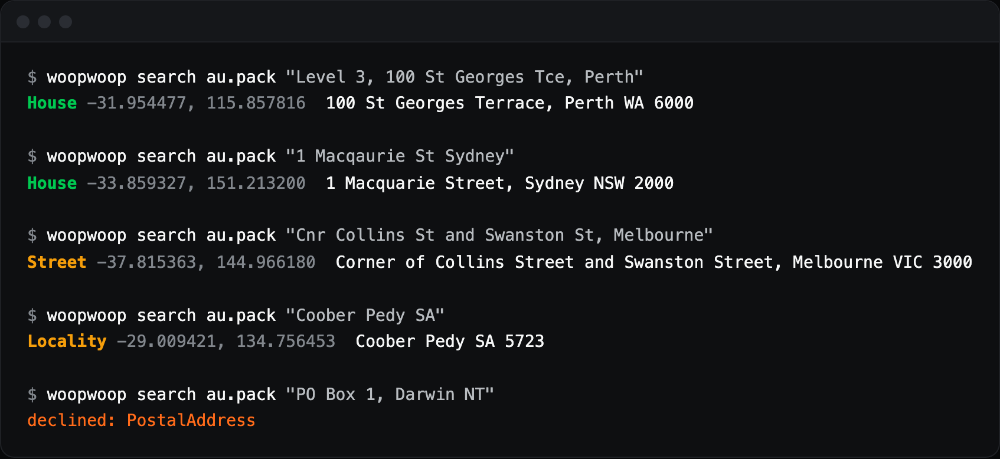

# WoopWoop

A small, fast address geocoder. Finds anywhere, even out in woop woop.



WoopWoop turns an address into coordinates. It runs inside your own process from one memory-mapped file, so addresses stay on your server and it works with no network.

Australia's 15.7 million addresses fit in a 181 MB pack, and America's 125 million in 1.9 GB. A search typically takes under 15 microseconds.

("Woop woop" is Australian slang for the middle of nowhere.)

## Use it

```rust
use woopwoop::{Outcome, Pack};

let pack = Pack::open("au.pack")?;

match pack.search("Level 3, 100 St Georges Tce, Perth") {
    Outcome::Found(candidates) => println!("{:?}", candidates[0]),
    Outcome::Declined(why) => println!("no result: {why:?}"),
}
```

Each candidate has a position, a label and a `precision` of `House`, `Street` or `Locality`. Show anything coarser than `House` as approximate.

- Units, levels, shops, number ranges and business names are all understood.
- Typos in street names are corrected.
- Ambiguous input, like a street that exists in several suburbs, returns each match.
- A match in a neighbouring suburb has `place_confirmed` set to false.
- PO boxes and unreadable text return `Outcome::Declined`.

WoopWoop reads Australian and American addresses today. It finds addresses, so it won't find a landmark by name.

## Build a pack

Packs aren't included.

For Australia, download [G-NAF](https://data.gov.au/data/dataset/geocoded-national-address-file-g-naf) and point the builder at its `Standard` folder:

```sh
cargo run --release -- build-gnaf "G-NAF/G-NAF AUGUST 2026/Standard" au.pack "G-NAF August 2026"
cargo run --release -- search au.pack "1 Macquarie St, Sydney"
```

For America, export addresses, towns and roads from [Overture Maps](https://docs.overturemaps.org/guides/addresses/) using the scripts in `eval/`, which need `duckdb`:

```sh
python eval/overture_export.py 2026-10-21.0 US us.tsv
python eval/overture_places.py 2026-10-21.0 US us-places.tsv
python eval/overture_roads.py 2026-10-21.0 us-roads.tsv -125,24.4,-66.5,49.5 -170,51,-130,71.5 -161,18.8,-154,22.4
cargo run --release -- build-overture us.tsv us-places.tsv us-roads.tsv us.pack "Overture 2026-10-21.0" US
```

Australia builds in about a minute with 1 GB of memory, and America in about four minutes with 6 GB.

## Accuracy

| Fresh test addresses, written 10 to 12 ways | Australia | United States |
| --- | --- | --- |
| Within 50 m | 97.1% | 92.8% |
| Over 1 km out | 0.1% | 3.1% |

Results resolve to the building, so units in large complexes account for most of Australia's gap.

These scores come from addresses in the same data as the pack, with generated formats. They show how well WoopWoop reads addresses. They can't show how accurate the data is, or what's missing from it.

American coverage has real gaps. Nevada and Georgia are far from complete, so many addresses there resolve only to the street. `eval/landmarks.py` checks well-known places against positions from outside the data: all 10 cities on its list resolve correctly, and 12 of 18 buildings land within 1 km.

Run your own with `woopwoop eval`, using `eval/formats.py` or `eval/formats_us.py` to generate the formats. Keep a sample you've never looked at, because fixing misses from a sample makes its score meaningless.

## Licence

The code is licensed under [Apache 2.0](LICENSE).

Packs carry the licences of their data. G-NAF uses the [Open G-NAF EULA](https://data.gov.au/data/dataset/geocoded-national-address-file-g-naf), based on CC BY 4.0, which restricts generating addresses for sending mail. Overture's addresses come from many sources with [different licences](https://docs.overturemaps.org/attribution/). Read them before distributing a pack.
